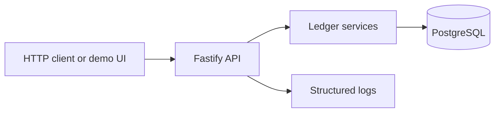

# Architecture

## Goal

Deliver the assignment's transaction ledger as a focused, locally runnable API with strong data integrity. The current balance is a cached projection on the account row; immutable transaction rows are the audit ledger. Both are updated in the same PostgreSQL transaction.

## Runtime shape



## Layers

1. **HTTP / route layer**: routes, parsing, schema validation, status codes, pagination, and error-envelope mapping. It does not contain balance arithmetic.
2. **Application / service layer**: `AccountService`, `LedgerService`, and optional `TransferService`. Own transaction boundaries and domain rules.
3. **Persistence layer**: Prisma repositories plus a small SQL helper for `SELECT ... FOR UPDATE`. Keep SQL isolated and parameterized.
4. **Database**: PostgreSQL constraints enforce UUID identity, positive amount, valid type, unique `(account_id, reference_id)`, and foreign keys.
5. **Optional UI**: React client calling only the public API. The UI never calculates authoritative balances or writes the database directly.

## Suggested project layout

```text
src/
  app.ts
  server.ts
  config/env.ts
  routes/{health,accounts,transactions,transfers}.ts
  schemas/{account,transaction,pagination}.ts
  services/{account-service,ledger-service,transfer-service}.ts
  repositories/{account-repository,transaction-repository}.ts
  errors/{app-error,error-handler}.ts
  plugins/{database,logger}.ts
  observability/request-context.ts
prisma/
  schema.prisma
  migrations/
tests/
  unit/
  integration/
web/                     # optional, only after API requirements pass
```

## Key decisions

- Use TypeScript and Fastify for a compact typed API with built-in schema support.
- Use PostgreSQL, not an in-memory store, so uniqueness, transactions, and row locks are real and testable.
- Store monetary values as integer minor units (`BIGINT`, paise) to avoid floating-point arithmetic. Accept and return decimal strings such as `"123.45"`; convert and validate at the API boundary.
- UUIDs identify accounts and transactions. Generate timestamps on the server and store UTC timestamps with timezone.
- Keep the account's `balance_minor` as a projection for a fast balance read. Write it with each immutable ledger event in the same transaction.
- Serialize mutations for one account by locking its account row. This prevents lost updates under concurrent credits/debits.
- Paginate history with bounded `limit`; order by `created_at DESC, id DESC` so ties have deterministic order.
- No auth, multi-tenancy, or AI integration is specified. Keep these out of scope and disclose the demo limitation.

## Request lifecycle

For a credit/debit request: validate input -> begin DB transaction -> lock account row -> check account exists -> check duplicate reference -> validate debit funds -> insert immutable transaction -> update balance projection -> commit -> respond. Any exception before commit rolls back both writes.

## Transfer extension

Implement only after the required API is complete. In one DB transaction, lock source and destination account rows in a stable UUID order, verify both exist and source funds suffice, then insert linked debit and credit events and update both balances. Enforce distinct accounts and positive amount. A `transfer_id` groups the two immutable transaction records. Any failure rolls back all four writes.

## Failure behavior

- Validation failures are 400.
- Missing resources are 404.
- Insufficient funds are 422.
- Duplicate reference retries return 200 with the existing transaction and `duplicate: true`; the first creation returns 201.
- Unexpected failures are 500 with a request ID and a safe message. Never return stack traces or database internals.
